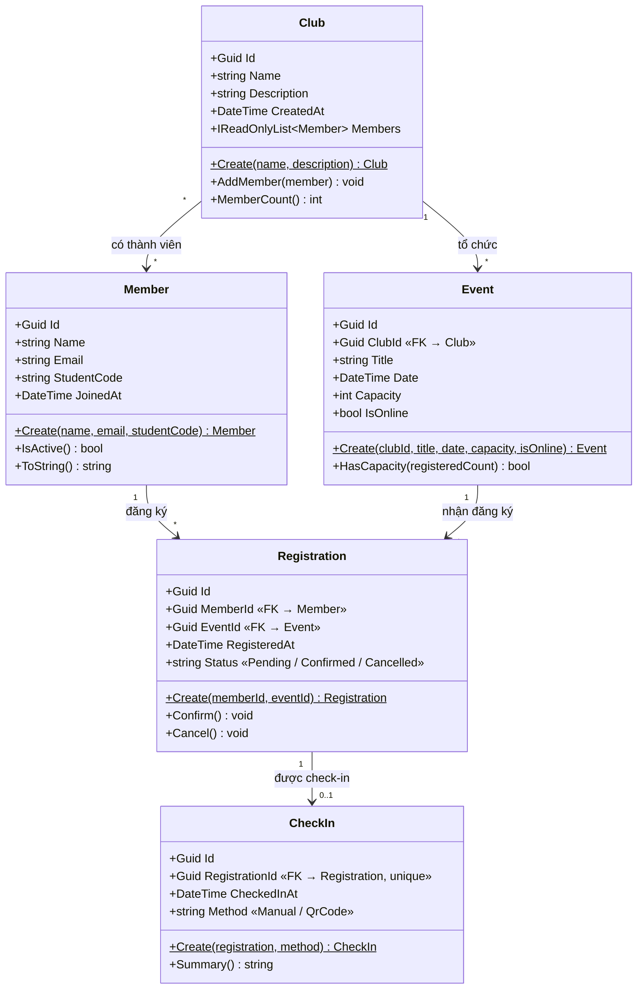

# Sơ đồ lớp sơ bộ — EduHub

Gồm 5 class: `Member`, `Club`, `Event`, `Registration`, `CheckIn`. Khoá ngoại (FK) ghi trong thuộc tính, bội số ghi trên đường nối.

## Giải thích bội số

| Quan hệ | Bội số | Ý nghĩa |
|---|---|---|
| Club – Event | 1 – * | Một CLB tổ chức nhiều sự kiện; mỗi sự kiện thuộc đúng một CLB (`Event.ClubId`). |
| Club – Member | * – * | Một CLB có nhiều thành viên; một sinh viên có thể tham gia nhiều CLB. |
| Member – Event | * – * | Quan hệ nhiều–nhiều, được tách thành bảng nối `Registration`. |
| Member – Registration | 1 – * | Một thành viên có thể có nhiều phiếu đăng ký. |
| Event – Registration | 1 – * | Một sự kiện có nhiều phiếu đăng ký (số lượng bị giới hạn bởi `Capacity`). |
| Registration – CheckIn | 1 – 0..1 | Một phiếu có tối đa một lần check-in; chưa đến sự kiện thì chưa có. |
